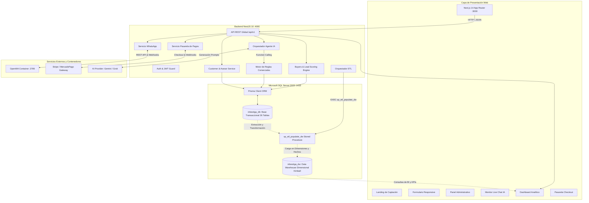

# Arquitectura Integral: INBESTIGA.TESIS

## 1. Visión General
**INBESTIGA.TESIS** es una plataforma tecnológica orientada al sector educativo superior para la aceleración y gestión integral de tesis y proyectos de investigación. Implementa el funnel metodológico **IMPULSE**:
```
UNIVERSO ──> BUYER ──> LEAD ──> PAYER ──> CUSTOMER
```

## 2. Diagrama de Arquitectura de Extremo a Extremo



## 3. Principio de Aislamiento de la Inteligencia Artificial
La IA (Gemini / Grok) **NUNCA** interactúa de forma directa o arbitraria con SQL Server. Su interacción está estrictamente acotada a herramientas backend (*Tool / Function Calling*):
1. `get_buyer_profile`: Obtiene únicamente los datos académicos del estudiante.
2. `get_available_services`: Consulta el catálogo oficial de servicios.
3. `calculate_offer`: Valida descuentos ante el Motor de Reglas Comerciales.
4. `record_objection`: Registra objeciones y devuelve guías de manejo.
5. `create_payment_request`: Genera órdenes oficiales y enlaces criptográficos de pago.
6. `escalate_to_human`: Deriva la atención a supervisión humana.
